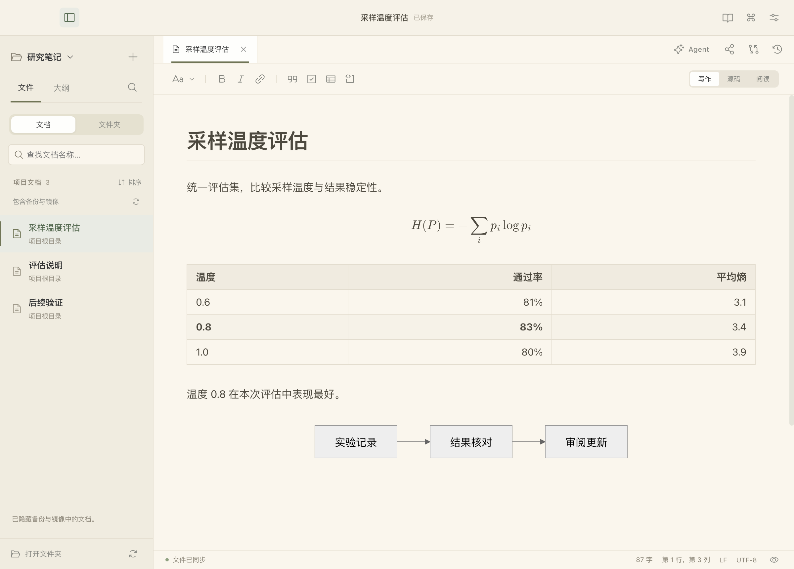
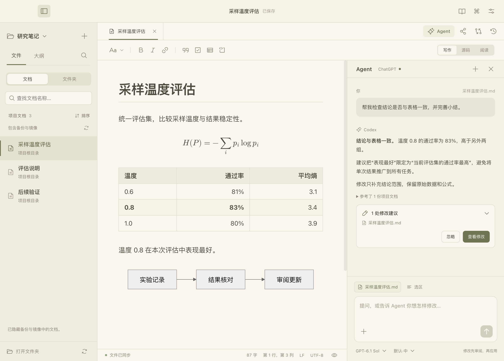

<p align="center">
  
</p>

<h1 align="center">Folio</h1>

<p align="center"><strong>让人和 Agent 围绕同一份文档工作</strong></p>

<p align="center">跨项目阅读、管理和编辑 Markdown，把日常写作与 Agent 协作连接起来。</p>

<p align="center">
  <a href="#快速开始">快速开始</a> ·
  <a href="#文档工作台">文档工作台</a> ·
  <a href="#文档旁的-agent">Agent</a> ·
  <a href="#分享同步与项目记忆">分享与同步</a> ·
  <a href="#文档与开发">文档</a> ·
  <a href="README.en.md">English</a>
</p>



## 文档工作台

计划、实验记录、技术方案和项目笔记，既来自人，也来自 Claude Code、Codex，或双方的持续协作。Folio 把这些散落在项目文件夹中的文档放到一个可阅读、可查找、可继续编辑的地方。

原文保持为普通 Markdown，沿用现有目录、相对路径和 Git。你可以继续使用熟悉的工具，让 Folio 负责阅读、编辑、审阅和恢复。

| 能力 | 使用体验 |
| --- | --- |
| 跨项目管理 | 常用项目、置顶、最近文档与跨项目标签；文档列表支持名称筛选、排序和目录定位 |
| 查找原文 | 搜索文件名与正文，按项目筛选，同名文档标明归属 |
| 阅读与写作 | 在同一区域切换写作、源码、阅读；支持主题、专注和打字机模式 |
| 公式、图与表 | LaTeX、Mermaid、图片与表格的预览和编辑；支持 PDF、HTML、Word 导出 |
| 文件协作 | 接收外部修改，保留未保存草稿，比较、合并和逐处审阅；恢复标签与历史版本 |
| 原生右键 | 正文格式、公式／图表／表格编辑、文档路径与重命名、标签保存与关闭 |

项目发现可从本机 Codex／Claude Code 记录中选择目录，并按需开启。项目文件保留在原位置；退出文档库不会删除磁盘原文。

## 快速开始

### 安装桌面应用

**[下载 Folio v0.5.0-beta.16 · macOS Apple Silicon](https://github.com/MemTensor/Folio/releases/download/v0.5.0-beta.16/Folio-0.5.0-beta.16-arm64-mac.zip)** · [版本说明](CHANGELOG.md)

解压，将 `Folio.app` 放入应用程序文件夹，然后打开 Markdown 文件或项目目录。

1. **找到文档**：从首页继续最近的文档，或添加、置顶常用项目。
2. **阅读和编辑**：点击段落进入写作；公式、图表与表格可打开专用编辑器。
3. **继续协作**：在 Agent 面板提出问题或修改要求，在改动审阅中确认更新。

基础阅读、编辑和本地搜索可离线使用，无需模型账号。界面支持简体中文与英语。

当前是私有测试版，下载需要 [MemTensor/Folio](https://github.com/MemTensor/Folio) 访问权限；安装包尚未完成 Developer ID 签名与 Apple 公证。项目标记为 `UNLICENSED`，未授予开源许可。

应用内可从 Folio 菜单或写作设置进入“检查更新”，查看说明、下载，并保留草稿后重启安装。私有更新复用本机 GitHub CLI 登录，详见 [更新说明](docs/更新说明.md)。

## 文档旁的 Agent



直接提问或描述修改要求，从一个输入框继续工作。上下文可以是当前草稿、选区，或你添加的参考文档。

- **理解内容**：总结、解释、检查结构与论证，按文档内容提出调整建议。
- **找到依据**：按需查找和读取同项目的 Markdown／文本，展开来源并打开原文。
- **核对排版**：支持图片输入的模型可调用只读预览，查看当前可见区域的公式、图表与表格。
- **审阅修改**：先对照原文，再选择接受；接受前保留历史，可撤销修改。
- **继续处理**：回复格式或原文定位有误时先反馈给模型修正；中断后保留指令供重试。

模型和思考强度可在面板中选择。自动读取限定在当前项目，工具提供文档查找、读取与可见预览；修改通过既有审阅流程进入编辑器。

### 选择接入方式

| 接入 | 准备 |
| --- | --- |
| ChatGPT 订阅 | 安装 [Codex CLI](https://learn.chatgpt.com/docs/cli)，在 Agent 设置中连接并完成官方页面登录，使用账号提供的 Codex 额度 |
| OpenAI 兼容 API | 填写服务地址、自己的 API Key 和模型名称，使用该服务的 API 额度 |

登录页未自动打开时，可以重新打开或复制登录链接。连接与凭据配置集中在 Agent 设置中。具体范围与操作见 [Agent 文档助手](docs/Agent文档助手.md)。

> 截图使用虚构文档与演示对话。文档建议与对话会把所选内容发送给你配置的模型服务；可见预览仅在模型调用工具时提供。

### 与 Claude Code、Codex 协作

Folio 提供独立 **CLI、skill 和 plugin**。外部 Agent 可查找文档、读取版本与章节、提交有版本检查的修改；桌面窗口关闭后仍可使用。

在源码目录中可以试用：

```bash
./bin/folio search "公式" --workspace ./examples --json
./bin/folio read "公式、图与表.md" --workspace ./examples --json
./bin/folio library add ./examples --json
./bin/folio library search "实验" --json
```

写入须提供读取时的版本，期间原文变化会要求重新读取。`read`、`search` 不会自动登记项目；需要长期检索时使用 `library add`。应用随包提供 CLI，接入方式和协议见 [Agent 接入指南](integrations/README.md)。

## 分享、同步与项目记忆

| 功能 | 范围 |
| --- | --- |
| 钉钉在线文档（实验性） | 通过本机已登录的 `dws` 发布或更新，检查云端版本；正文、表格可编辑，公式与 Mermaid 以图片呈现 |
| iCloud Drive | 按项目开启，包含 Markdown 与引用的本地图片／附件，单文件小于 100 MB；双侧修改冲突由你选择 |
| MemOS（可选） | 配置 API Key 并选择或创建项目知识库，由 Agent 经 CLI／skill 维护文档导航与检索线索 |

MemOS 帮助后续任务找到原文，本地 Markdown 始终是文档来源。分享、同步和记忆分别配置，详见 [钉钉集成](docs/钉钉集成说明.md)、[项目与同步](docs/项目与同步.md) 与 [Agent 接入](integrations/README.md)。

## 文档与开发

| 文档 | 内容 |
| --- | --- |
| [使用指南](docs/使用指南.md) | 文档管理、写作、公式与图表、右键、审阅、导出、快捷键 |
| [Agent 文档助手](docs/Agent文档助手.md) | 接入、上下文、思考强度、预览和修改审阅 |
| [Agent 接入指南](integrations/README.md) | 独立 CLI、Codex／Claude Code skill 与 plugin |
| [架构与数据边界](docs/架构与数据边界.md) | 代码入口、数据保存与云端传输范围 |
| [开发指南](docs/开发指南.md) | 环境、检查、构建与发布 |
| [第三方组件](THIRD_PARTY_NOTICES.md) | 依赖与授权说明 |

从源码运行需要 macOS、Node.js 22.13+ 和 npm：

```bash
git clone https://github.com/MemTensor/Folio.git
cd Folio
npm ci
node node_modules/electron/install.js
npm run desktop
```

验证与构建使用 `npm run check`、`npm run pack` 和 `npm run dist`。提交规范见 [参与开发](CONTRIBUTING.md)，安全问题见 [安全说明](SECURITY.md)。

反馈连接或操作问题时，可在写作设置或 Agent 设置中**导出诊断信息**。本地日志最多约 1 MB，仅保留运行事件与错误类别，不记录正文、对话、凭据或登录链接。

## 路线图

- 多窗口与跨会话阅读位置恢复。
- 跨文件引用、反向链接和相关文档导航。
- Developer ID 签名、公证与更多平台支持。
