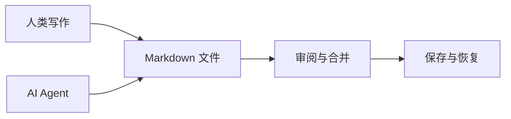

# Markdown 语法手册

[toc]

## 行内格式

**粗体**、*斜体*、~~删除线~~、==高亮==、`行内代码`、H~2~O、x^2^ 和 :sparkles:。

[返回欢迎页](欢迎使用%20Folio.md) · [Markdown 指南](https://www.markdownguide.org/)

## 列表

1. 写下一个想法
2. 补充论据
   - 一个例子
   - 另一个例子
3. 整理成文

- [x] 完成的任务
- [ ] 尚未完成的任务

> 引用让另一种声音进入文章。
>
> 引用也可以包含多个段落。

> [!NOTE]
> 外部文件变化会显示在协作面板。未保存的内容会保留为草稿。

## 表格

| 功能 | 快捷键 | 说明 |
| :--- | :---: | ---: |
| 保存 | ⌘ S | 写入 Markdown |
| 查找 | ⌘ F | 查找与替换 |
| 命令 | ⌘ ⇧ P | 所有操作 |

点击表格进入编辑，可通过表格工具增加行列。

## 代码

```typescript
interface Document {
  path: string;
  content: string;
  revision: string;
}

const write = (document: Document) => document.content;
```

## 数学公式

行内公式：$E = mc^2$。

$$
\mathcal{L}(\theta) = -\sum_{i=1}^{N}\log p_\theta(x_i \mid x_{<i})
$$

## 图表



## 脚注

想法可以保持简洁，把补充材料放在脚注中。[^note]

[^note]: 文档存储为 UTF-8 纯文本，普通编辑不会重排未修改的内容。

---

祝你写得愉快。
