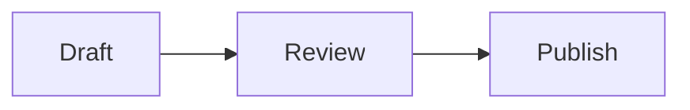

# Markdown Guide

## Headings and text

Use `#`, `##` and `###` for headings. Use **bold**, *italic* and `inline code` for emphasis.

## Lists

- A list item
- Another item

1. First step
2. Second step

- [ ] A task
- [x] A completed task

## Links and images

[Project website](https://github.com/MemTensor/Folio)

Images use ordinary Markdown: ``. Relative paths stay relative to the document. Network images require enabling them in settings or from their placeholder.

## Code

```python
print('Hello, Folio')
```

## Equations

Use `$x^2$` for inline math and `$$` on separate lines for display math. LaTeX delimiters `\(x^2\)` and `\[x^2\]` are also supported.

## Tables

| Item | Description |
| --- | --- |
| Markdown | Plain text source |
| Folio | Reading, editing and review |

## Diagrams



Use the block editor to adjust a table, equation or diagram. Switch to Source to edit the original text directly.
