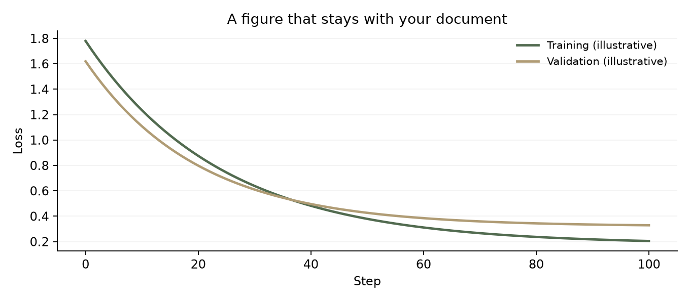
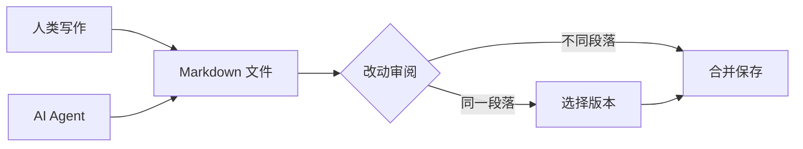
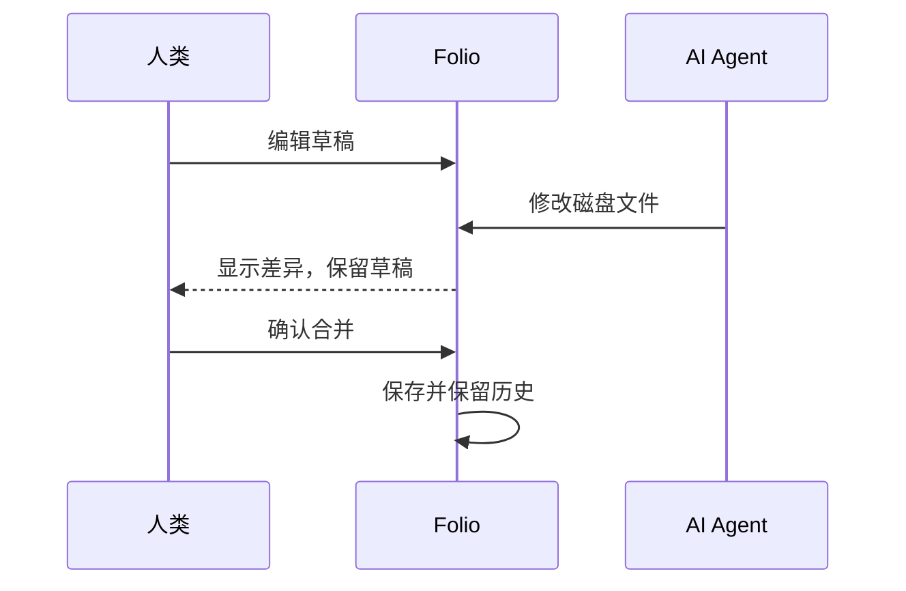

# 公式、图与表

让严谨的表达，也拥有清晰的形状。这份文档用于检查公式、图像、图表、表格在编辑与导出时的表现。

## 01 · 公式

行内公式 $E = mc^2$ 与正文处在同一行，$\alpha + \beta = \gamma$ 保留上下标与希腊字母。

**训练目标**

$$
\mathcal{L}(\theta) = -\frac{1}{N}\sum_{i=1}^{N}\log p_\theta(x_i\mid x_{<i}) \tag{1}
$$

**矩阵与多行对齐**

$$
A = \begin{pmatrix} a & b \\ c & d \end{pmatrix},\qquad
\begin{aligned}
f(x) &= (x+1)^2 \\
     &= x^2 + 2x + 1
\end{aligned}
$$

**分段函数与化学式**

$$
f(x) = \begin{cases} x^2 & x \ge 0 \\ -x & x < 0 \end{cases}
\qquad \ce{CO2 + C -> 2 CO}
$$

## 02 · 图片

图片保存在文档旁边的 `assets` 文件夹中。复制、移动整个文件夹时，图片链接仍然有效。

## 03 · 图表

## 04 · 表格

| 项目 | 数学表达 | 状态 | 说明 |
| :--- | :---: | :---: | ---: |
| 均值 | $\mu=\frac{1}{n}\sum_i x_i$ | 已检查 | 行内公式 |
| 方差 | $\sigma^2=E[(X-\mu)^2]$ | 已检查 | 上下标 |
| 转义符号 | `a\|b` | 待检查 | 单元格中的竖线 |
| 文本格式 | **粗体**与*斜体* | 已检查 | 富文本显示 |
| 中文换行 | 第一行 第二行 | 已检查 | 两行内容 |

## 05 · 验收清单

- [ ] 公式没有缺字、重影或截断
- [ ] 图片可以显示，导出后不依赖原始路径
- [ ] Mermaid 中文标签与箭头完整
- [ ] 表格对齐、边框与单元格内容正确
- [ ] 导出的 PDF 和 HTML 保留矢量公式与图表

> 表格和公式始终保留 Markdown／LaTeX 源码，Agent 可以直接做局部修改。
